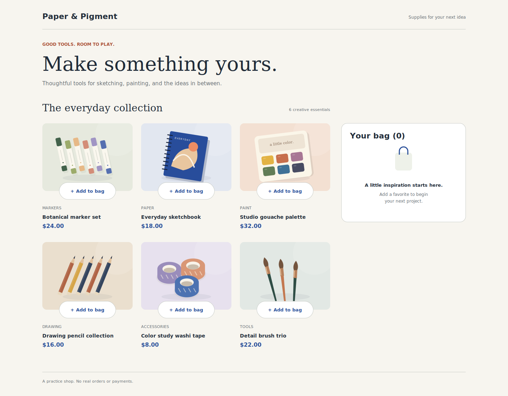

# Paper & Pigment - Product list with cart

An original frontend practice challenge prepared for Antoine Randle. Inspired by the organization of challenge starter kits; not a Frontend Mentor challenge or an affiliated product. Build a small art-supply storefront using semantic HTML, vanilla CSS, JavaScript, and Vite.

## The brief
Paper & Pigment is a fictional art-supply shop for everyday creative practice. Build its six-product listing and an in-page cart. The visual direction combines cream paper, cobalt actions, editorial serif headings, and original product illustrations.

Focus on JavaScript state and keeping multiple parts of an interface synchronized. This is one page; it does not require product detail pages, accounts, a checkout backend, or payments.

## Your users should be able to
- Browse six products with category, name, image, and USD price.
- Add a product to the cart. Its Add to bag button becomes a quantity control set to 1.
- Increase or decrease a quantity using real buttons. Decreasing from 1 removes the product.
- Remove an entire cart line with its remove control.
- See the total number of units in the cart heading, each line subtotal, and the order total update together.
- See the original empty state after removing the last item.
- Confirm a nonempty order and see a dialog summarizing the same items and total.
- Dismiss the dialog with its close control or Escape without losing the cart, and return focus to Confirm order.
- Choose Start new order to clear the cart, close the dialog, reset product controls, and focus the first product's Add to bag button.
- Use all controls by keyboard and see visible hover/focus states.
- Use the page from 320px wide through desktop without horizontal scrolling.

## Exact rules
- Prices are USD. Data uses integer `priceCents`; show dollars with two decimals. The order total is the sum of unit price times quantity. No tax, shipping, discounts, or inventory calculations.
- Each product appears once in the cart. Repeated additions change quantity, not the number of lines.
- Cart lines follow first-added order. Removed and re-added products go to the end.
- Quantities are positive whole numbers with no challenge-specific maximum; 0 removes the item. Never show negatives or an empty quantity control.
- The cart heading counts units, not distinct products. Example: 2 markers + 1 sketchbook means Your bag (3).
- Hide the total and Confirm order control when the cart is empty.
- Confirmation is a demo only. No message, payment, or order is sent; display the supplied demo note in the dialog.
- The dialog is scrollable when necessary and keeps keyboard focus inside it while open. Native dialog is a useful option to investigate.
- Clicking the backdrop may do nothing; closing by backdrop is not required.
- No cart persistence is required. A page reload starts a fresh cart in the core version.

## Assets and data
- `data.json`: six fictional products with stable id, name, category, priceCents, image path, alt suggestion, width, and height.
- `public/images/`: six original product illustrations as SVG and PNG. JSON points to 800x600 PNGs. Same composition at all breakpoints: separate mobile crops are not necessary. SVGs remain sharp at any size.
- `public/icons/`: plus, minus, close, check, bag, and favicon SVGs. Give icon-only buttons accessible names. External SVG images do not inherit a button's currentColor; inline an SVG when you need that behavior.
- `public/fonts/`: local DejaVu Sans regular/bold and DejaVu Serif regular in TTF, with license.
- `design/`: desktop, tablet, mobile, cart, and confirmation references as PNG and SVG. These are static references, not working application code. No native Figma file is included; SVG references can be imported into design tools.

The supplied image paths assume Vite's default root deployment, as on Netlify. During learning, a Vite JSON import is sufficient; remote API fetching and loading/error screens are not required. Build one static card before learning dynamic rendering.

## Suggested milestones
1. Semantic structure and local fonts.
2. One product card, then the grid and empty bag.
3. Responsive layout and focus styles.
4. Render the supplied product data.
5. Add/remove products; calculate quantities and totals from cart state.
6. Confirmation and reset, including focus behavior.
7. Acceptance checks, production preview, and deployment.

See START-HERE.md for setup and acceptance-checklist.md for concrete test cases. Aim to understand each milestone rather than completing every feature at once.

## Optional extensions - after core completion
- Persist the cart with localStorage, validating stored IDs and quantities.
- Add a dark theme with accessible color pairs.
- Add category filtering and a results count.
- Write a few tests for quantity changes and total calculations.

## Documentation and publishing
Keep the brief as CHALLENGE.md when you finish. Use README-template.md to write your own final README with screenshots, live/source URLs, what you learned, and an honest account of AI assistance. Product images and design references are original to this kit; see ASSET-CREDITS.md. This project can be shown as a fictional portfolio practice project.

## Commands
- First installation: `npm install`
- Development: `npm run dev`
- Build: `npm run build`
- Local production preview: `npm run preview`
- Netlify: branch main, base directory blank, build command npm run build, publish directory dist.
